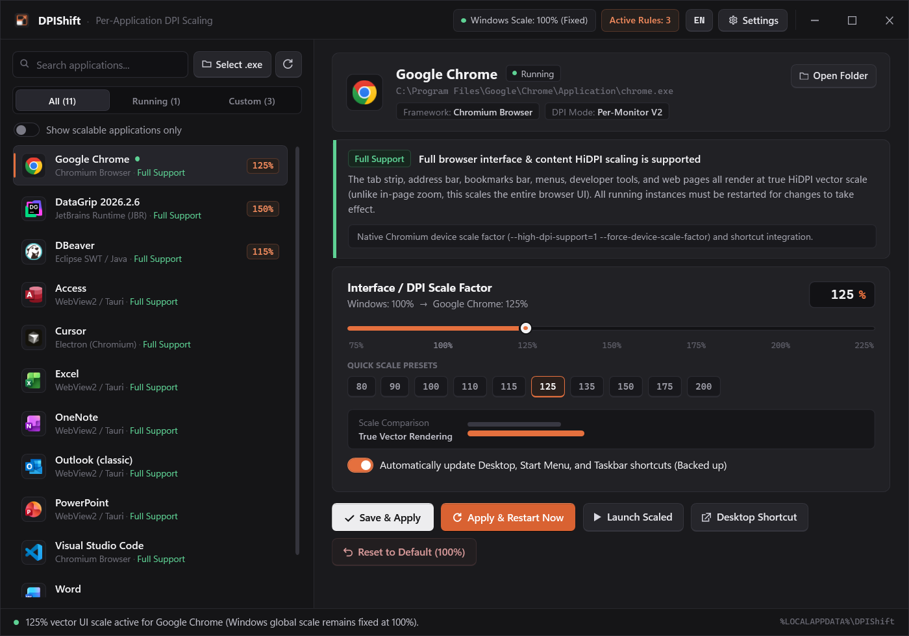

<p align="center">
  
</p>

<h1 align="center">DPIShift</h1>

<p align="center">
  <strong>Per-Application Display &amp; UI DPI Scaling Manager for Windows</strong>
</p>

<p align="center">
  
  
  
  <a href="LICENSE"></a>
</p>

<p align="center">
  
</p>

---

## Overview

**DPIShift** lets you configure independent UI/DPI scaling factors (**75% – 225%**) for individual desktop applications while keeping your global Windows display scale untouched (e.g., at **100%**).

Unlike tools that merely resize windows, apply blurry bitmap stretching, or rely on in-page browser zoom, DPIShift passes native HiDPI scale factors directly to each application's rendering engine—ensuring tabs, sidebars, menus, icons, and text are rendered as crisp vectors.

| Target | Scale | Behavior |
| :--- | :---: | :--- |
| **Windows Global Display Scale** | `100%` | Remains fixed system-wide |
| **Google Chrome / Edge / Brave** | `125%` | Browser tabs, address bar, menus, and content render at true `125%` HiDPI |
| **Discord / VS Code / Cursor / Obsidian** | `110%` | Entire application interface renders crisply at `110%` |
| **DataGrip / IntelliJ IDEA / PyCharm** | `150%` | Toolbars, project trees, tables, icons, and editor render at `150%` |
| **OBS Studio / VLC / DBeaver** | `125%` | Application UI scales independently at `125%` |

---

## Key Features

- **Automatic Compatibility Detection:** Scans installed and running applications to identify supported UI frameworks automatically.
- **True Vector HiDPI Scaling:** Applies framework-native scaling rather than blurry bitmap magnification.
- **Shortcut & Profile Integration:** Automatically backs up and updates Desktop, Start Menu, and Taskbar shortcuts.
- **Lossless One-Click Rollback:** Restores modified shortcuts, configuration files, and runtime DPI states back to `100%` default behavior at any time.
- **Lightweight System Tray Mode:** Runs quietly in the Windows system tray with minimal memory footprint, **0% idle CPU usage**, and optional startup on Windows login.
- **Game & Anti-Cheat Safe:** Does not use DLL injection, global hooks, or administrator privileges (`UAC`), ensuring zero impact on gaming performance or anti-cheat software.
- **Bilingual Interface:** Built-in **English** (default) and **Turkish** (`EN / TR`) interface language support.

---

## Supported Application Frameworks

| Application Framework | Support Level | Restart Required |
| :--- | :---: | :---: |
| **Chromium Browsers** *(Chrome, Edge, Brave, Vivaldi, Opera)* | Full Support | Yes |
| **Electron & Squirrel** *(Discord, VS Code, Cursor, Slack, Notion, Obsidian)* | Full Support | Yes |
| **CEF & WebView2 / Tauri** *(Spotify, etc.)* | Full Support | Yes |
| **JetBrains IDEs** *(DataGrip, IntelliJ, PyCharm, WebStorm, Rider, Android Studio)* | Full Support | Yes |
| **Eclipse / SWT & Java Desktop** *(DBeaver, Eclipse, JavaFX, Swing)* | Full Support | Yes |
| **Qt 5 & Qt 6** *(OBS Studio, VLC, Wireshark, KeePassXC, Krita, Calibre)* | Full Support | Yes |
| **.NET WPF & Modern WinForms (Per-Monitor V2)** | Full Support | No *(Instant)* |
| **GTK 3 / GTK 4 & Native Win32 (Per-Monitor V2)** | Partial Support | App-Dependent |
| **Legacy Win32 / GDI, UWP & 3D Games** | Unsupported | — |

---

## Getting Started

1. Download the latest executable from the **[Releases](../../releases)** page:
   - **`DPIShift.exe`** *(Recommended — Self-Contained Single EXE)*: Runs out of the box with zero runtime prerequisites.
   - **`DPIShift-light.exe`** *(Lightweight Single EXE)*: Compact build for systems that already have the `.NET 8 Desktop Runtime` installed.
2. Launch `DPIShift.exe`, select an application from the sidebar (or add one via **Select .exe**).
3. Choose your target scale percentage and click **Save & Apply** (or **Apply & Restart Now** if the application is currently running).

> User profiles and rollback backups are stored locally in `%LOCALAPPDATA%\DPIShift`.

---

## Building from Source

### Prerequisites
- Windows 10 (1809+) or Windows 11
- [.NET 8.0 SDK](https://dotnet.microsoft.com/download) (or newer)

### Build & Package

```powershell
# Runs automated tests and produces single-file executables in dist\
powershell -ExecutionPolicy Bypass -File .\build.ps1
```

To build or run tests manually:

```powershell
dotnet build DPIShift.sln -c Release
dotnet test DPIShift.sln -c Release
```

---

## License

Licensed under the [MIT License](LICENSE).
